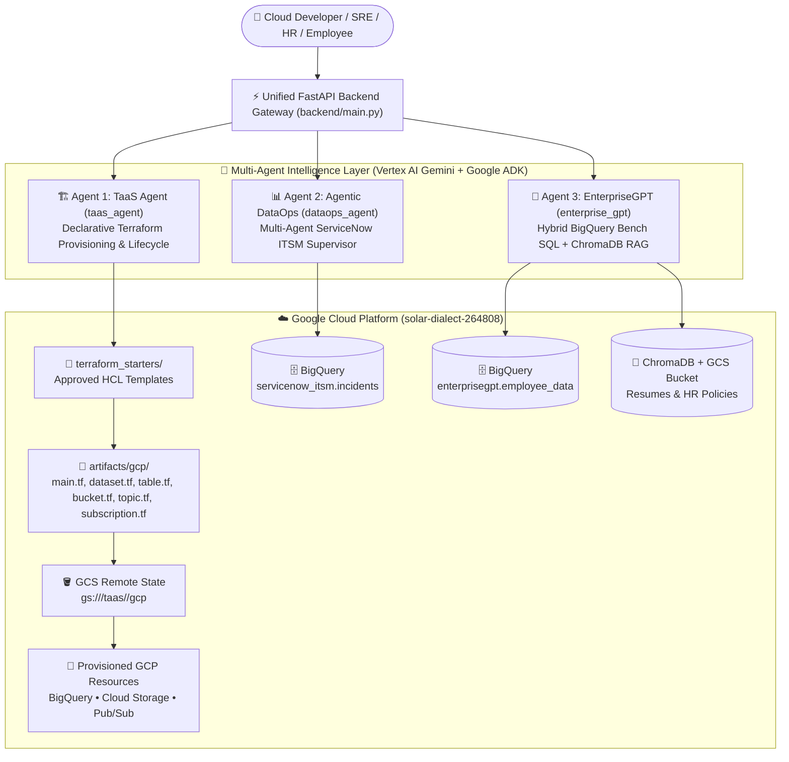

# Agentic Terraform-as-a-Service (TaaS) & Unified Enterprise AI Platform 
# WORK IN PROGRESS

Welcome to the repository for **Agentic Terraform-as-a-Service (TaaS) & Unified Enterprise AI Platform**! Hope you will learn a lot about building production-grade, governance-first **Agentic Cloud Infrastructure**, **Agentic DataOps**, and **Enterprise RAG + Text-to-SQL** systems on **Google Cloud Platform (GCP)** using **Google Agent Development Kit (ADK)**, **Vertex AI Gemini**, **Terraform**, **BigQuery**, **ChromaDB**, and **FastAPI**.

---

## 1. Introduction & Motivation

In modern cloud-native enterprises, engineering, operations, and HR teams interact with three critical but traditionally siloed workflows:
1. **Cloud Infrastructure Provisioning (DevOps / Platform Engineering):** Writing Terraform HCL from scratch, configuring remote GCS state backends, reviewing plans, and safely decommissioning resources without breaking shared state files is error-prone and time-consuming.
2. **ITSM & Operational Incident Analytics (DataOps / SRE):** Analyzing thousands of ServiceNow incidents in BigQuery to compute Mean Time To Resolve (MTTR), active backlog aging, and assignment group bottlenecks typically requires manual SQL queries and custom dashboards.
3. **Corporate Talent & Policy Intelligence (HR & Employees):** HR teams need to cross-reference structured employee bench allocation tables in BigQuery with unstructured candidate resumes and company policy PDFs stored in Google Cloud Storage (GCS) and Vector Databases.

**Agentic Terraform-as-a-Service (TaaS)** unifies all three paradigms into a single, deterministic, human-in-the-loop **Multi-Agent Platform**:
- **Deterministic Guardrails Over Hallucination:** Agents never invent raw shell commands or unreviewed infrastructure code. Every Terraform resource is generated from reviewed starter templates (`terraform_starters/`), validated via Abstract Syntax Tree (AST) plan inspection, and gated by mandatory human approval (`apply` / `dont apply`) verified with a cryptographic **SHA-256 plan digest**.
- **Non-Destructive Lifecycle Management:** Deactivating a cloud resource comments out (`#`) only that specific HCL block inside `artifacts/gcp/<resource>.tf` and runs a targeted destroy against remote GCS state—preserving the exact configuration history for 1-click recreation.
- **Zero-SQL-Injection Operational Analytics:** DataOps agents query BigQuery exclusively through parameterized `QueryJobConfig` tools rather than raw LLM-generated SQL execution.

---

## 2. System Architecture



---

## 3. Repository Structure

```text
Agentic-Terraform-as-a-Service/
├── backend/
│   └── main.py                                  # Unified FastAPI Gateway (/api/taas/*, /api/dataops/*, /api/enterprise/*)
├── taas_agent/                                  # AGENT 1: Terraform-as-a-Service (Google ADK)
│   ├── agent.py                                 # TaaSAgent definition, system instructions & confirmation gate
│   ├── skills/
│   │   └── terraform-provisioning/SKILL.md      # ADK Skill defining provisioning & deactivation workflows
│   └── tools/
│       └── tools.py                             # Deterministic lifecycle tools (generate, plan, apply, deactivate, recreate, verify)
├── dataops_agent/                               # AGENT 2: Agentic DataOps (ServiceNow ITSM Analytics)
│   ├── agent.py                                 # ServiceNowMasterAgent + 5 Specialist Sub-Agents
│   └── tools.py                                 # Parameterized BigQuery tools (MTTR, Aging, Opened/Closed counts)
├── enterprise_gpt/                              # AGENT 3: EnterpriseGPT (HR Bench SQL + Document RAG)
│   └── service.py                               # Document classifier, BigQuery bench SQL, ChromaDB RAG & GCS upload
├── terraform_starters/                          # Approved Terraform HCL templates (Single Source of Truth)
│   ├── common/
│   │   ├── main.tf                              # Google provider & GCS remote backend configuration
│   │   └── variables.tf                         # Standard project_id & location input variables
│   └── gcp/
│       ├── bigquery_dataset/dataset.tf          # BigQuery Dataset starter template
│       ├── bigquery_table/table.tf              # BigQuery Table starter template
│       ├── storage_bucket/bucket.tf             # Cloud Storage Bucket starter template
│       ├── pubsub_topic/topic.tf                # Pub/Sub Topic starter template
│       └── pubsub_subscription/subscription.tf  # Pub/Sub Subscription starter template
├── artifacts/
│   └── gcp/                                     # Runtime Terraform workspace (stateful HCL + backend.tfvars)
├── frontend/                                    # React + Vite Web Studio (🚧 In Development)
├── run.py                                       # Standalone interactive CLI runner for TaaS
├── setup.sh                                     # One-click Cloud Shell environment & persistent Terraform installer
└── requirements.txt                             # Python dependencies
```

---

## 4. Prerequisites & Initial Setup

1. **Google Cloud Account & Project:**
   - Access to a Google Cloud Platform project (e.g., `solar-dialect-264808`) with billing enabled.
   - Enable the following APIs: **Vertex AI API**, **BigQuery API**, **Cloud Storage API**, and **Cloud Pub/Sub API**.
   - Create a versioned GCS bucket to store remote Terraform state (e.g., `gs://terraform-implementation`).

2. **Clone the Repository in Google Cloud Shell:**
   Open [Google Cloud Shell](https://shell.cloud.google.com/) and clone the repository:
   ```bash
   git clone https://github.com/adityasolanki205/Agentic-Terraform-as-a-Service.git
   cd Agentic-Terraform-as-a-Service
   ```

3. **Run the Automated Setup Script (`setup.sh`):**
   Execute `setup.sh` to install a persistent Terraform `v1.9.8` binary in `$HOME/.local/bin/terraform` (so it survives Cloud Shell container restarts), create the Python virtual environment, install dependencies, and generate `.env`:
   ```bash
   bash setup.sh
   ```

---

## 5. Agent 1: Terraform-as-a-Service Agent (`taas_agent`)

### 5.1 Overview & Provisioning Lifecycle
The **TaaS Agent** (`taas_agent`) is a declarative infrastructure assistant built with the **Google Agent Development Kit (ADK)** and **Vertex AI Gemini**. Instead of allowing an LLM to write arbitrary, unverified HCL files or run raw shell commands, the agent operates through a strict **9-stage deterministic lifecycle**:

1. **Requirement Collection:** Collects `project_id`, `location` (default `asia-south2`), `resource_name`, and resource-specific parameters (such as `dataset_id` and optional JSON `schema` for BigQuery tables, or parent `topic` for Pub/Sub subscriptions).
2. **Template Rendering (`generate_resource_files`):** Copies `main.tf` and `variables.tf` from `terraform_starters/common/` into `artifacts/gcp/` and renders the target resource block from `terraform_starters/gcp/<resource_type>/` into its shared file (`dataset.tf`, `table.tf`, `bucket.tf`, `topic.tf`, or `subscription.tf`).
3. **Pre-Plan Code Review & Customization (`read_artifact_code` / `update_artifact_code`):** Displays the generated HCL before planning. Users can customize labels, retention policies, or lifecycle rules, and `update_artifact_code` automatically validates syntax with `terraform fmt`.
4. **Live Provider Documentation Lookup (`lookup_terraform_docs`):** Queries official HashiCorp Google Provider documentation on demand without disk caching.
5. **Remote State Initialization & Plan (`plan_resource`):** Runs `terraform init -reconfigure -backend-config=backend.tfvars` against `gs://<TAAS_STATE_BUCKET>/taas/<project_id>/gcp`, executes `terraform plan -out=tfplan`, and inspects the JSON plan (`terraform show -json tfplan`).
6. **AST Change-Set Validation & SHA-256 Digest:** Verifies that *only* the requested resource address is in the planned change-set and computes a cryptographic `plan_sha256` digest of the binary plan file.
7. **Human-in-the-Loop Approval Gate (`apply_resource`):** Execution pauses until the user explicitly selects `apply` or `dont apply`. Before applying, `apply_resource` recomputes the SHA-256 hash of `tfplan` to guarantee the plan was not tampered with.
8. **Asynchronous Cloud Verification (`verify_resource`):** Queries Google Cloud APIs (`bigquery`, `storage`, `pubsub`) with retry backoff to confirm the resource is live in GCP.
9. **Safe Deactivation & 1-Click Recreation (`plan_deactivate_resource` / `plan_recreate_resource`):** Commenting out (`#`) a resource block in `artifacts/gcp/<file>.tf` and applying the destroy removes the cloud resource while keeping its HCL configuration intact for future 1-click recreation.

---

### 5.2 Approved Terraform Starters (`terraform_starters/`)

All infrastructure originates from reviewed starter templates in `terraform_starters/`.

#### `terraform_starters/common/main.tf` & `variables.tf`
Configures the Google Terraform provider and the remote GCS backend:

```hcl
terraform {
  required_version = ">= 1.5.0"
  required_providers {
    google = {
      source  = "hashicorp/google"
      version = ">= 5.0, < 8.0"
    }
  }
  backend "gcs" {}
}

provider "google" {
  project = var.project_id
}
```

#### `terraform_starters/gcp/storage_bucket/bucket.tf`
Starter template for Google Cloud Storage buckets with uniform bucket-level access and object versioning enabled by default:

```hcl
# Google Cloud Storage bucket resource template.
resource "google_storage_bucket" "requested" {
  name                        = var.resource_config["bucket_name"]
  project                     = var.project_id
  location                    = var.location
  force_destroy               = false
  uniform_bucket_level_access = true

  versioning {
    enabled = lookup(var.resource_config, "versioning", true)
  }
}
```

---

### 5.3 ADK Agent & Confirmation Gate (`taas_agent/agent.py`)

In `taas_agent/agent.py`, the agent loads the `terraform-provisioning` skill from `taas_agent/skills/terraform-provisioning/SKILL.md` and wraps `apply_resource` inside an ADK `FunctionTool` with `require_confirmation=True`. This enforces a mandatory human approval gate before any cloud mutation occurs:

```python
from pathlib import Path
from google.adk import Agent
from google.adk.skills import load_skill_from_dir
from google.adk.tools import skill_toolset
from google.adk.tools.function_tool import FunctionTool

from .tools import (
    apply_resource,
    generate_resource_files,
    get_request_status,
    list_taas_resources,
    lookup_terraform_docs,
    plan_deactivate_resource,
    plan_recreate_resource,
    plan_resource,
    read_artifact_code,
    update_artifact_code,
    verify_resource,
)

# Load declarative provisioning skill
provisioning_skill = load_skill_from_dir(
    Path(__file__).parent / "skills" / "terraform-provisioning"
)
provisioning_skill_tools = skill_toolset.SkillToolset(skills=[provisioning_skill])

# ADK pauses for explicit user confirmation before applying any Terraform plan
apply_tool = FunctionTool(
    apply_resource,
    require_confirmation=True,
)

root_agent = Agent(
    name="TaaSAgent",
    model=os.getenv("TAAS_MODEL", "gemini-3.5-flash-lite"),
    description=(
        "Manages approved cloud resources through a declarative Terraform-as-a-Service "
        "workflow with reviewable artifacts, documentation lookup, code customization, "
        "approval gates, deactivation, and verification."
    ),
    instruction="...",
    tools=[
        provisioning_skill_tools,
        generate_resource_files,
        read_artifact_code,
        update_artifact_code,
        lookup_terraform_docs,
        plan_resource,
        apply_tool,
        plan_deactivate_resource,
        plan_recreate_resource,
        verify_resource,
        get_request_status,
        list_taas_resources,
    ],
)
```

---

### 5.4 Deterministic Lifecycle Tools (`taas_agent/tools/tools.py`)

#### 1. Resource Registry (`SUPPORTED_RESOURCES`)
Maps each normalized resource type to its starter directory, target `.tf` file in `artifacts/gcp/`, and HCL resource type:

```python
SUPPORTED_RESOURCES = {
    "gcp.bigquery_dataset": {
        "provider": "gcp",
        "short_name": "bigquery_dataset",
        "starter_dir": STARTERS_DIR / "gcp" / "bigquery_dataset",
        "primary_tf": "dataset.tf",
        "resource_type_hcl": "google_bigquery_dataset",
        "name_param": "dataset_id",
        "description": "Google Cloud BigQuery Dataset",
    },
    "gcp.bigquery_table": {
        "provider": "gcp",
        "short_name": "bigquery_table",
        "starter_dir": STARTERS_DIR / "gcp" / "bigquery_table",
        "primary_tf": "table.tf",
        "resource_type_hcl": "google_bigquery_table",
        "name_param": "table_id",
        "description": "Google Cloud BigQuery Table",
    },
    "gcp.storage_bucket": {
        "provider": "gcp",
        "short_name": "storage_bucket",
        "starter_dir": STARTERS_DIR / "gcp" / "storage_bucket",
        "primary_tf": "bucket.tf",
        "resource_type_hcl": "google_storage_bucket",
        "name_param": "bucket_name",
        "description": "Google Cloud Storage Bucket",
    },
    "gcp.pubsub_topic": {
        "provider": "gcp",
        "short_name": "pubsub_topic",
        "starter_dir": STARTERS_DIR / "gcp" / "pubsub_topic",
        "primary_tf": "topic.tf",
        "resource_type_hcl": "google_pubsub_topic",
        "name_param": "topic_name",
        "description": "Google Cloud Pub/Sub Topic",
    },
    "gcp.pubsub_subscription": {
        "provider": "gcp",
        "short_name": "pubsub_subscription",
        "starter_dir": STARTERS_DIR / "gcp" / "pubsub_subscription",
        "primary_tf": "subscription.tf",
        "resource_type_hcl": "google_pubsub_subscription",
        "name_param": "subscription_name",
        "description": "Google Cloud Pub/Sub Subscription",
    },
}
```

#### 2. Non-Destructive Resource Deactivation & Recreation
When deactivating a resource, `_comment_out_resource_block` locates the target `resource "<type>" "<name>" { ... }` block by brace-depth tracking and prefixes each line with `# `. When recreating, `_uncomment_resource_block` restores the exact block:

```python
def _comment_out_resource_block(file_path: Path, resource_type_hcl: str, tf_name: str) -> bool:
    """Comment out a specific active resource block in a shared .tf file."""
    if not file_path.is_file():
        return False
    content = file_path.read_text(encoding="utf-8")
    span = _find_active_resource_span(content, resource_type_hcl, tf_name)
    if not span:
        return False

    start, end = span
    block_text = content[start:end]
    commented_lines = [
        f"# {line}" if line.strip() else "#"
        for line in block_text.splitlines()
    ]
    commented_block = "\n".join(commented_lines)
    updated = content[:start] + commented_block + content[end:]
    file_path.write_text(updated, encoding="utf-8")
    return True
```

#### 3. SHA-256 Plan Verification & Gated Apply (`apply_resource`)
Before executing `terraform apply`, `apply_resource` checks that the user explicitly confirmed `"apply"` and verifies that the binary plan's SHA-256 digest matches the approved record:

```python
def apply_resource(
    request_id: str,
    plan_sha256: str,
    confirmation: Literal["apply", "dont apply"] = "dont apply",
) -> dict:
    """Apply a previously generated and approved Terraform plan."""
    record = _load_record(request_id)

    if confirmation.strip().lower() != "apply":
        _set_status(record, "PLAN_CANCELLED", "User chose 'dont apply'. No cloud changes made.")
        return {"status": "PLAN_CANCELLED", "request_id": request_id}

    plan_file = Path(record["plan_file"])
    actual_digest = hashlib.sha256(plan_file.read_bytes()).hexdigest()
    if actual_digest != plan_sha256 or actual_digest != record.get("plan_sha256"):
        raise ValueError("Plan SHA-256 digest mismatch! Refusing to apply modified plan.")

    # Execute `terraform apply -auto-approve <plan_file>` against remote GCS state
    ...
```

---

## 6. Agent 2: Agentic DataOps — ServiceNow Incident Analytics (`dataops_agent`)

### 6.1 Overview & Multi-Agent Supervisor Architecture
The **Agentic DataOps** module (`dataops_agent`) provides natural-language operational intelligence over ServiceNow ITSM incident records stored in Google BigQuery (`solar-dialect-264808.servicenow_itsm.incidents`).

It uses a hierarchical **Multi-Agent Supervisor Pattern** where the lead `ServiceNowMasterAgent` delegates analytical tasks across **5 specialized sub-agents**:
1. **`IncidentSummaryAgent`** — Computes total incident volume and active open backlog (`New`, `In Progress`, `On Hold`) grouped by assignment group (`Database Admin`, `Network Support`, `Service Desk`, `Cloud Infrastructure`, `Cyber Security`, `Application Dev`).
2. **`OpenedIncidentAgent`** — Analyzes ticket inflow (`opened_date`) for a specific `MONTH`/`YEAR` or `ALL` time scope, returning summary counts by default and row-level details on demand.
3. **`ClosedIncidentAgent`** — Tracks incident resolution throughput (`closed_date` where `status = 'Closed'`) across teams and time periods.
4. **`MTTRAgent`** — Calculates **Mean Time To Resolve (MTTR)** in hours and days (`TIMESTAMP_DIFF(closed_date, opened_date, MINUTE) / 60.0`) overall and per assignment group.
5. **`AgingAgent`** — Measures active backlog aging in days for currently open tickets to surface SLA risks.

---

### 6.2 Multi-Agent Hierarchy (`dataops_agent/agent.py`)

`dataops_agent/agent.py` defines each specialist agent with its dedicated toolset and binds them under `ServiceNowMasterAgent`:

```python
from google.adk import Agent
from .tools import (
    calculate_mttr,
    calculate_mttr_by_group,
    calculate_open_incident_aging,
    calculate_open_incident_aging_by_group,
    count_all_incidents,
    count_closed_incidents,
    count_closed_incidents_by_group,
    count_open_incidents_by_group,
    count_opened_incidents,
    get_closed_incident_details,
    get_opened_incident_details,
)

incident_summary_agent = Agent(
    name="IncidentSummaryAgent",
    model=os.getenv("DATAOPS_MODEL", "gemini-3.5-flash-lite"),
    description="Specialist for overall incident counts and open backlog breakdown by assignment group.",
    instruction="Use count_all_incidents and count_open_incidents_by_group to report high-level incident counts.",
    tools=[count_all_incidents, count_open_incidents_by_group],
)

mttr_agent = Agent(
    name="MTTRAgent",
    model=os.getenv("DATAOPS_MODEL", "gemini-3.5-flash-lite"),
    description="Specialist for calculating Mean Time to Resolve (MTTR) on closed incidents.",
    instruction="Use calculate_mttr and calculate_mttr_by_group to report MTTR in hours and days.",
    tools=[calculate_mttr, calculate_mttr_by_group],
)

aging_agent = Agent(
    name="AgingAgent",
    model=os.getenv("DATAOPS_MODEL", "gemini-3.5-flash-lite"),
    description="Specialist for calculating active backlog aging on currently open incidents.",
    instruction="Use calculate_open_incident_aging and calculate_open_incident_aging_by_group to report aging in days.",
    tools=[calculate_open_incident_aging, calculate_open_incident_aging_by_group],
)

dataops_root_agent = Agent(
    name="ServiceNowMasterAgent",
    model=os.getenv("DATAOPS_MODEL", "gemini-3.5-flash-lite"),
    description="Lead ServiceNow incident analytics supervisor agent.",
    instruction=DATAOPS_SYSTEM_INSTRUCTION,
    sub_agents=[
        incident_summary_agent,
        opened_incidents_agent,
        closed_incidents_agent,
        mttr_agent,
        aging_agent,
    ],
)
```

---

### 6.3 Parameterized BigQuery Analytics (`dataops_agent/tools.py`)

To eliminate SQL injection risks and date-math hallucinations, `dataops_agent/tools.py` constructs parameterized `bigquery.ScalarQueryParameter` and `bigquery.ArrayQueryParameter` bindings for every query:

```python
def _build_date_filter(
    date_column: str,
    time_scope: str,
    month: int | None = None,
    year: int | None = None,
) -> tuple[list[str], list]:
    """Build parameterized UTC timestamp bounds for opened_date or closed_date."""
    scope = (time_scope or "ALL").upper().strip()
    conditions: list[str] = []
    parameters: list = []

    if scope == "MONTH":
        start_date = datetime(int(year), int(month), 1, tzinfo=timezone.utc)
        end_date = (
            datetime(int(year) + 1, 1, 1, tzinfo=timezone.utc)
            if int(month) == 12
            else datetime(int(year), int(month) + 1, 1, tzinfo=timezone.utc)
        )
        conditions.append(f"{date_column} >= @start_date")
        conditions.append(f"{date_column} < @end_date")
        parameters.extend([
            bigquery.ScalarQueryParameter("start_date", "TIMESTAMP", start_date),
            bigquery.ScalarQueryParameter("end_date", "TIMESTAMP", end_date),
        ])
    return conditions, parameters


def calculate_mttr_by_group(
    time_scope: str = "ALL",
    month: int | None = None,
    year: int | None = None,
) -> dict:
    """Calculate Mean Time To Resolve (MTTR) in hours and days grouped by assignment_group."""
    project_id, dataset_id, table_id = _get_bq_config()
    client = bigquery.Client(project=project_id)
    table_name = f"`{project_id}.{dataset_id}.{table_id}`"

    conditions, parameters = _build_date_filter("closed_date", time_scope, month, year)
    conditions.insert(0, "status = 'Closed'")
    conditions.insert(1, "opened_date IS NOT NULL AND closed_date IS NOT NULL")
    where_clause = f"WHERE {' AND '.join(conditions)}"

    query = f"""
        SELECT
            assignment_group,
            COUNT(*) AS closed_count,
            ROUND(AVG(TIMESTAMP_DIFF(closed_date, opened_date, MINUTE) / 60.0), 2) AS mttr_hours,
            ROUND(AVG(TIMESTAMP_DIFF(closed_date, opened_date, MINUTE) / 1440.0), 2) AS mttr_days
        FROM {table_name}
        {where_clause}
        GROUP BY assignment_group
        ORDER BY mttr_hours DESC
    """
    config = bigquery.QueryJobConfig(query_parameters=parameters)
    result = client.query(query, job_config=config).result()
    ...
```

---

## 7. Agent 3: EnterpriseGPT — HR & Corporate Intelligence (`enterprise_gpt`)

### 7.1 Overview & Hybrid SQL + RAG Architecture
**EnterpriseGPT** (`enterprise_gpt/service.py`) serves both **HR Administrators** and **Enterprise Employees** with role-based access controls:
- **HR Administrator Mode (`role = "hr"`):**
  - **Automated Document Ingestion & Classification:** Uploaded `.pdf`, `.docx`, and `.txt` files are automatically classified as either a `resume` or a `policy` using NLP entity recognition (`spaCy`) and structural heuristics, uploaded to Google Cloud Storage (`gs://enterprisegpt_bucket/<doc_type>/`), chunked with `RecursiveCharacterTextSplitter`, and indexed in **ChromaDB**.
  - **Hybrid Bench Talent Discovery:** When HR asks about unallocated/bench employees, EnterpriseGPT queries the structured BigQuery table (`solar-dialect-264808.enterprisegpt.employee_data`) AND automatically cross-references **ChromaDB** metadata to attach direct GCS download links for each bench employee's resume.
- **Employee Mode (`role = "employee"`):**
  - Restricts access strictly to corporate policy documents (`doc_type = "policy"`) in ChromaDB so employees can ask questions about leave, compliance, and benefits without exposing sensitive HR bench data or candidate resumes.

---

### 7.2 Document Classifier & Hybrid Bench Lookup (`enterprise_gpt/service.py`)

#### 1. Heuristic + NLP Document Classifier (`extract_features` & `classify_document`)
Automatically distinguishes candidate resumes from corporate policy documents during upload:

```python
def classify_document(text: str) -> str:
    """Classify a document as 'resume' or 'policy' based on feature scores."""
    f = extract_features(text)
    resume_score = (
        f["has_email"] * 2
        + f["has_phone"] * 2
        + f["years"]
        + f["resume_sections"] * 2
        + f["bullets"]
        + f["person_entities"]
    )
    policy_score = (
        f["policy_sections"] * 2
        + f["modal_verbs"] * 2
        + f["org_entities"]
        + f["governance_terms"] * 3
        + (3 if f["bullets"] == 0 else 0)
    )
    return "resume" if resume_score >= policy_score else "policy"
```

#### 2. BigQuery Bench SQL + ChromaDB Resume Link Enrichment
Queries `solar-dialect-264808.enterprisegpt.employee_data` for bench availability and enriches each matching employee record with their GCS resume URL stored in ChromaDB:

```python
def query_bench_employees(question: str) -> list[dict]:
    """Generate and execute a BigQuery SELECT query for bench employees."""
    sys_prompt = (
        f"You are an HR analytics assistant.\n"
        f"Write a BigQuery SELECT query ONLY using table {FULL_TABLE_NAME}.\n"
        f"Columns: id, name, department, is_on_bench (BOOL), bench_start_date (DATE), "
        f"project_id, allocation_pct, last_updated_at.\n"
        f"Return ONLY the SELECT statement."
    )
    sql = _generate_with_llm(sys_prompt, question)
    sql = re.sub(r"^```(?:sql)?\s*|\s*```$", "", sql.strip(), flags=re.IGNORECASE)
    client = bigquery.Client(project=PROJECT_ID)
    return [dict(row) for row in client.query(sql).result()]


def fetch_resume_links_for_bench(bench_names: set[str]) -> dict[str, str]:
    """Retrieve resume GCS links from ChromaDB for a set of employee names."""
    resume_links: dict[str, str] = {}
    vs = get_vectorstore()
    for name in bench_names:
        results = vs.get(
            where={"$and": [{"doc_type": "resume"}, {"employee_name": name}]},
            include=["metadatas"],
        )
        for meta in results.get("metadatas", []):
            if meta and meta.get("gcs_link"):
                resume_links[name] = meta["gcs_link"]
                break
    return resume_links
```

---

## 8. Unified FastAPI Gateway (`backend/main.py`)

The FastAPI backend (`backend/main.py`) exposes REST endpoints for all three agents (`/api/taas/*`, `/api/dataops/*`, and `/api/enterprise/*`) and manages multi-turn Vertex AI Gemini sessions with automatic endpoint fallback (`global` $\rightarrow$ `us-central1`):

```python
@app.post("/api/taas/chat")
def taas_chat(req: ChatRequest):
    """Stateful conversational endpoint for the Terraform-as-a-Service Agent."""
    chat_config = types.GenerateContentConfig(
        system_instruction=TAAS_CHAT_SYSTEM_INSTRUCTION,
        tools=TAAS_SAFE_CHAT_TOOLS,
        temperature=0.1,
    )
    candidates = [
        ("global", preferred_model),
        ("global", "gemini-2.5-flash"),
        ("us-central1", "gemini-2.5-flash"),
    ]
    # Reuse existing session or initialize a new Vertex AI chat session
    if req.session_id in _TAAS_SESSIONS:
        response = _TAAS_SESSIONS[req.session_id].send_message(req.message)
    else:
        for loc, mdl in candidates:
            client = genai.Client(vertexai=True, project=project, location=loc)
            chat_session = client.chats.create(model=mdl, config=chat_config)
            response = chat_session.send_message(req.message)
            _TAAS_SESSIONS[req.session_id] = chat_session
            break

    artifacts_data = read_artifact_code()
    req_info = _get_latest_request_info()
    return {
        "status": "SUCCESS",
        "response": response.text,
        "files": artifacts_data.get("file_details", {}),
        **req_info,
    }
```

---

## 9. Running the Agents (CLI, ADK Web & FastAPI Server)

### Option 1: Interactive Terminal CLI (`run.py`)
Run the TaaS Agent directly in your terminal with interactive approval prompts:
```bash
cd ~/Agentic-Terraform-as-a-Service
source venv/bin/activate
python run.py
```

### Option 2: Built-in Google ADK Web UI
Launch the Google ADK developer interface:
```bash
cd ~/Agentic-Terraform-as-a-Service
source venv/bin/activate
adk web --port 8080 --allow_origins "regex:https://.*\.cloudshell\.dev"
```

### Option 3: Start the Unified FastAPI Backend Server (Port `8000`)
```bash
cd ~/Agentic-Terraform-as-a-Service
source venv/bin/activate
pkill -9 -f uvicorn 2>/dev/null || true
uvicorn backend.main:app --host 0.0.0.0 --port 8000 --reload
```

---

## 10. Frontend Web Studio (🚧 In Development)

> **Status:** *In Development* — A unified React + Vite single-page studio (`frontend/`) featuring a Gemini-style conversational workspace, expandable 1-Click TaaS resource catalog, Pre-Plan HCL code editor, approval gate controls, and live GCP resource inventory is actively under development.

To run the frontend development server alongside the FastAPI backend in Google Cloud Shell:
```bash
cd ~/Agentic-Terraform-as-a-Service/frontend
npm install
npm run dev
```

---

## 11. Credits

- **Author:** [Aditya Solanki](https://github.com/adityasolanki205)
